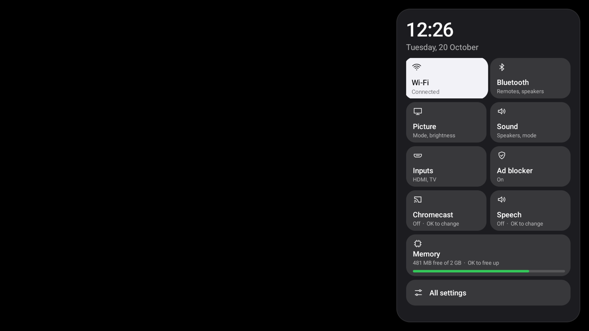
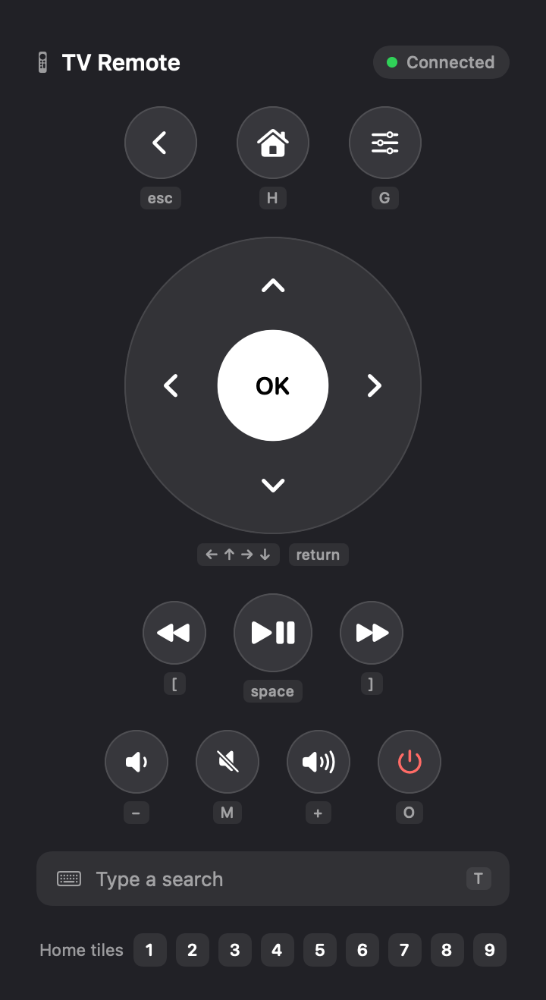

<div align="center">

# TV Detox: Bento

### A fast, ad-free, Apple TV-style home screen for slow Android TVs.

A fork of [Ansub Khan's TV Detox](https://github.com/Ansub/tv-detox) with a bento-grid home screen, a TV-friendly web browser, a Control Center sidebar, a photo screensaver, a network ad blocker, a Mac remote, and backup and restore.

</div>

Built and tested on a 2 GB Sony BRAVIA (KD-43X75L, Google TV 14). It should work on any Android TV or Google TV that the original works on. Everything can be undone.

## What you get

**Home screen**
- A bento grid that fits one screen, with no scrolling. Your most-used app gets the big tile, and the order follows how much you watched each app in the last 30 days.
- The highlighted app's name in big type, with its artwork glowing softly behind the grid.
- A clock and weather card, and a memory card (press OK on it to free RAM).
- Hold OK on any tile to move it, replace it or remove it.

**Website tiles** that open full screen in a browser made for the remote:
- The arrows jump between the page's links and buttons with a white highlight, like a TV app. No mouse cursor (hold OK if you ever need one).
- OK on a video player fills the screen and starts it. Back returns to the page.
- Sites get their full desktop layout instead of the phone one.
- Popups and redirects to other sites are blocked. Typed text goes straight into the site's search box.
- The browser closes fully when you leave it, so its ~140 MB goes back to the TV.

**Settings sidebar:** the remote's settings button opens a Control Center-style panel with Wi-Fi, Bluetooth, Picture, Sound, Inputs, an ad blocker switch, Chromecast and Speech on/off, Memory, and All settings.

**Remote buttons keep working.** Turning off Google TV's home screen normally breaks the settings, Netflix, Prime and YouTube buttons on many remotes. A small key service makes them work again.

**Screensaver:** Bing's photo of the day, drifting slowly, with the time, date and weather. The photo is downloaded ahead of time, so the screensaver uses almost no memory.

**Ad blocker for the whole TV,** using AdGuard's free DNS. You can switch it off in the sidebar. (YouTube's own ads can't be blocked this way.)

**From a Mac** (optional):
- **TV Remote:** press Control+Option+Space anywhere and a remote pops up. Your keyboard (or mouse) drives the TV, including typing searches.
- **Weekly tune-up:** once a week, while the TV is idle, it clears app caches and closes background apps.

**Backup and restore:** `backup.sh` saves your tiles, the apps you turned off and your settings to a folder. `restore.sh` rebuilds the whole setup after a factory reset or on another TV.



## Get started

You need a Mac or PC with `adb` (`brew install android-platform-tools` on a Mac), the TV and the computer on the same Wi-Fi, and developer mode on the TV (Settings, then About, then press **Build** 7 times, then turn on **USB debugging** in Developer options). [Stuck?](#help)

```sh
git clone https://github.com/thisissamridh/tv-detox-bento && cd tv-detox-bento
sh build.sh                    # builds the home screen app (needs Java 17 and the Android SDK, see below)
sh install.sh <TV_IP>          # installs it and makes it your home screen
sh tune.sh <TV_IP> debloat/sony-bravia.txt   # the extras; each step asks first
sh tiles.sh <TV_IP>            # your apps and websites (see "Pick your tiles")
```

Find your TV's IP under Settings, then Network, then your Wi-Fi network. The first time you connect, the TV asks "Allow debugging?": tick "Always allow" and press Allow.

`tune.sh` asks before each step: the remote button fix, the screensaver, the ad blocker, faster animations, and turning off the apps in a debloat list. Read [`debloat/sony-bravia.txt`](debloat/sony-bravia.txt) first and put a `#` in front of anything you want to keep. On other brands, ask Claude or Codex to make a list for your TV the same way. Add `COMPILE=1` to pre-compile your apps for faster launches (slow, about 20 minutes; it helped YouTube and Prime by about 30% on the test TV).

Prefer to let an AI do it? Open [Claude Code](https://claude.com/claude-code) in this folder and say: *"Set up my Android TV at <TV_IP> with this repo. Ask me before every change."*

### Pick your tiles

```sh
cp tiles.example.txt tiles.txt   # edit it: one app or website per line
sh tiles.sh <TV_IP>
```

A tile is an app's package name, or `web:` plus any website's address, which opens full screen in the remote-friendly browser. Add `#` and a name (`web:https://example.com/home#Films`) to show that name with the site's own icon. Apps that aren't installed are skipped. `tiles.txt` is in `.gitignore`, so your list stays on your computer. You can also add tiles on the TV: press OK on **Add app**.

### The Mac remote



Press **Control+Option+Space** anywhere on your Mac. Every button shows its key, and lights up as you press it; you can also click them.

| Key | Does |
|---|---|
| Arrows, Return | Move, OK |
| Esc or Delete | Back |
| H, G | Home, settings sidebar |
| Space, [ ] | Play or pause, rewind, forward |
| + − M | Volume, mute |
| O | TV on or off |
| T | Type a search: it goes into the TV's search box |
| 1 to 9 | Open home tile 1 to 9 (1 is the big one) |

<br clear="right">

```sh
sh mac/install.sh <TV_IP>      # remote app (starts at login) and the weekly tune-up
sh mac/install.sh --remove     # removes both
```

It needs Xcode's command-line tools for `swiftc` (`xcode-select --install`). The tune-up only runs while the TV is idle and your Mac is awake on the same Wi-Fi. It logs to `~/Library/Logs/tv-tune.log`.

### Back up and restore

```sh
sh backup.sh <TV_IP>                       # saves to backups/<date>
sh restore.sh <TV_IP> backups/2026-10-20   # after a reset: install your apps first, then run this
```

Backups hold no passwords or app data: just your tiles, which apps are off, and the settings `tune.sh` changes.

### Undo

```sh
sh undo.sh <TV_IP>
```

This turns every app back on, puts back the settings `tune.sh` changed (ad blocker, animations, screensaver, key service), and removes the home screen. A factory reset also removes everything.

## Help

<details>
<summary><b>How do I turn on developer mode?</b></summary>
<br>

1. On the TV, open **Settings**, then **Device Preferences** (or **System**), then **About**.
2. Press OK on **Build** 7 times until you see "You are now a developer."
3. Go back, open **Developer options** and turn on **USB debugging**. If you see **Network debugging** or **Wireless debugging**, turn that on too.
4. The first time your laptop connects, the TV asks "Allow debugging?" Tick "Always allow" and press **Allow**.

Menus differ a bit by brand. If you're stuck, ask Claude or Codex: *"I have a \<brand and model\> TV. How can you connect to it from my laptop and take control of it?"*

</details>

<details>
<summary><b>Which TVs does it work on?</b></summary>
<br>

Android TV 9 (a real TV), 11 and 12, and Google TV 14. Every change is tested automatically on emulators.

</details>

<details>
<summary><b>Can I do this on a Fire TV, Roku, Samsung or LG?</b></summary>
<br>

- **Amazon Fire TV:** partly. Fire TV is Android underneath, so the cleanup works. Amazon blocks changing the home screen on current Fire TVs, so you keep Amazon's. Tell Claude what you want to keep, like Alexa voice search on the remote.
- **Roku:** no. Roku runs its own system, not Android, so nothing can connect to it to turn things off.
- **Samsung (Tizen):** no, for the same reason.
- **LG (webOS):** no. You can still cut down the ads by turning off **Home Promotion** and **Content Recommendation** in the TV's home settings.

If your TV or streaming box runs Android TV or Google TV, it should work. That includes many Sony, TCL, Hisense, Philips and Xiaomi TVs, Chromecast with Google TV and Nvidia Shield. Some of those brands also sell Roku or other non-Android models, so check **Settings > About** if you're not sure.

</details>

<details>
<summary><b>What about projectors or Android phones?</b></summary>
<br>

- **Android projectors:** probably. If it has **Developer options** and **USB debugging**, the cleanup should work. Cheap projectors often run a custom Android, so the home screen may act a bit differently.
- **Android phones:** only the cleanup. The home screen is made for a TV remote, not touch.

</details>

<details>
<summary><b>Anything to watch out for on Chromecast with Google TV?</b></summary>
<br>

It runs the same Google TV this is tested on, so it should work. People who've done it report two things:

- The YouTube button on the remote can stop working, and some lose casting. Tell Claude to keep casting on if you use it.
- Google TV can bring its own home screen back. If that happens, ask Claude to turn off Google TV's home screen. Leave its setup app on unless it's taking over Home (see below).

</details>

<details>
<summary><b>Home opens Google TV's setup screen instead (Sony BRAVIA and others)</b></summary>
<br>

On some Google TVs, once Google TV's home screen (`com.google.android.apps.tv.launcherx`) is off, Android picks the setup app (`com.google.android.tungsten.setupwraith`) for Home instead. `install.sh` spots this and asks before turning the setup app off too. It only asks if Home opens exactly that app, Google TV's home screen is already off and the TV has finished its first setup. `YES=1` doesn't turn it off; use `YES_SETUP=1` for that. This worked on a Sony BRAVIA, but it hasn't been tested on every TV. `undo.sh` turns it back on.

To undo it by hand:

```sh
adb shell pm enable com.google.android.tungsten.setupwraith
adb shell pm enable com.google.android.apps.tv.launcherx
```

If the TV ever asks to be set up again, or a setup screen won't finish, turn the setup app back on first.

</details>

<details>
<summary><b>The Claude app says it can't reach my TV</b></summary>
<br>

The chat in the Claude app (and claude.ai) runs on Anthropic's servers, not on your laptop, so it can't see your TV. You need something that runs on your own laptop: [Claude Code](https://claude.com/claude-code) or [Codex](https://openai.com/codex).

Don't want to pay for either? Skip the AI and use `install.sh` instead (see "Can I install the home screen without AI?" below).

</details>

<details>
<summary><b>Can I do it from my phone, without a laptop?</b></summary>
<br>

Not yet. Claude has to run on a computer on the same network as your TV. A phone hotspot is fine as that network, as long as the laptop and TV both join it.

</details>

<details>
<summary><b>My TV is on Ethernet, not Wi-Fi</b></summary>
<br>

That works the same. Your laptop talks to the TV over its IP address on your home network, so cable or Wi-Fi doesn't matter. The laptop just has to be on the same network. You'll find the TV's IP in its network settings, or ask Claude to find it.

</details>

<details>
<summary><b>Can I just do the cleanup and keep my TV's home screen?</b></summary>
<br>

Yes. Leave out step 5 of the prompt ("Install the home screen"). Your TV looks the same, just with the junk turned off.

</details>

<details>
<summary><b>Why not just use Projectivy Launcher?</b></summary>
<br>

You can. The cleanup is the part that makes the TV faster, and it works with any home screen. This one is here if you want something tiny and open source: one screen, no ads, no account, about 30 MB of RAM.

</details>

<details>
<summary><b>The TV still opens Live TV or HDMI when it turns on</b></summary>
<br>

That's a TV setting, not this home screen. Ask it: *"My TV opens Live TV at startup instead of the home screen. Find that setting and turn it off."*

</details>

<details>
<summary><b>A button on the remote stopped working</b></summary>
<br>

Some remote buttons are handled by the TV's own home screen or by apps the cleanup turned off. To see which app handles which button, ask Claude: *"Run `adb shell dumpsys window policy` and tell me which apps my remote's global keys go to."* If it's an app other than your TV's home screen, turn that app back on.

**The YouTube button on some Google TVs** (seen on Xiaomi and Vu): it goes to Google TV's own home screen, which `install.sh` turns off, so the button does nothing. Turning that home screen back on brings the button back, but your TV may then open Google TV's home screen again instead of this one. Until there's a safe fix, open YouTube from its tile on the home screen.

</details>

<details>
<summary><b>An update turned something back on</b></summary>
<br>

```sh
sh check.sh <TV_IP>                  # check the home screen is still in charge
sh check.sh <TV_IP> --fix            # and fix it
sh check.sh <TV_IP> --fix my-tv.txt  # also check your own list of changes
```

Your list has one change per line, like `off com.example.app`, `global window_animation_scale 0` or `device_config activity_manager max_cached_processes 4`. Ask Claude to write it from the changes it made.

</details>

<details>
<summary><b>Can I install the home screen without AI?</b></summary>
<br>

Yes. You need `adb`, plus Java 17 and the Android SDK to build the app the first time (see "For developers: build it yourself" below; `install.sh` builds it for you). On a Mac, run `brew install android-platform-tools`. On Windows, download Google's [SDK Platform Tools](https://developer.android.com/tools/releases/platform-tools), unzip it, and run the commands below from Git Bash. Download this repo, then:

```sh
sh install.sh <TV_IP>                                               # picks your TV apps for you
sh install.sh <TV_IP> "com.netflix.ninja,com.hulu.livingroomplus"   # or choose them
sh install.sh <TV_IP> "" "bluetooth,sound,picture"    # add settings shortcuts
```

Most TVs keep opening their own home screen, so the script offers to turn that off. Nothing is uninstalled.

</details>

<details>
<summary><b>How do I change the apps on the home screen?</b></summary>
<br>

Use the remote. Hold **OK** on an app (or press **Menu**) to:

- **Move** it: use the arrows to slide it to a new spot, then press **OK** to finish.
- **Replace** it: pick another app to take its place.
- **Remove** it from the home screen. The app stays installed, and you can add it back any time.
- **Uninstall** it, for apps you installed yourself. The TV asks you to confirm first.
- **App info**, for apps that came with the TV. They can't be uninstalled, but from there you can turn them off.

To add an app, pick the **Add app** tile in the bottom row. Add as many apps as you like: they wrap into rows of six, and the page scrolls once there are more than twelve. Your changes are kept until you run `install.sh` with a new app list.

</details>

<details>
<summary><b>Can I get Wi-Fi and Bluetooth one press away?</b></summary>
<br>

Yes. A small network icon always sits next to the clock. It shows **Wi-Fi** (with signal bars), **Ethernet** or a crossed-out Wi-Fi when you're offline, and opens your network settings. **Bluetooth**, **Sound** and **Picture** shortcuts can join it. They're off unless you ask for them:

```sh
sh install.sh <TV_IP> "" "bluetooth,sound,picture"   # pick any of them, in any order
sh install.sh <TV_IP> "" "none"                                    # take them away
```

Press **Up** from your apps to reach them. A shortcut your TV has no screen for is left out. On TCL TVs, Sound and Picture open TCL's own panels.

</details>

<details>
<summary><b>How do I undo it?</b></summary>
<br>

```sh
sh undo.sh <TV_IP>
```

This turns your TV's own home screen back on and removes this one. To undo the cleanup too, ask Claude or Codex to reverse everything on its list.

</details>

<details>
<summary><b>My TV is stuck restarting</b></summary>
<br>

Your laptop can often still connect for a few seconds each time the TV starts. Use that to turn everything back on:

```sh
adb connect <TV_IP>
adb wait-for-device
adb shell pm list packages -d
```

That lists everything that's turned off. Turn each one back on with `adb shell pm enable <package>`, or all of them at once:

```sh
for p in $(adb shell pm list packages -d | tr -d '\r' | sed 's/package://'); do adb shell pm enable "$p"; done
```

To undo just the home screen, run `sh undo.sh <TV_IP>`. Then restart the TV. You can redo the cleanup later, one app at a time.

If the laptop never connects, use the TV's recovery mode or a factory reset. How you get there depends on the brand and model, so check your TV maker's support page.

</details>

<details>
<summary><b>For developers: build it yourself</b></summary>
<br>

1. Put your default apps in `apps.txt` (package names, one per line). You can also pass them to `install.sh` instead.
2. Install Java 17 and the Android SDK. On a Mac:
   ```sh
   brew install openjdk@17
   brew install --cask android-commandlinetools
   sdkmanager "platforms;android-34" "build-tools;34.0.0"
   ```
3. `sh build.sh`, then `sh install.sh <TV_IP>` installs your build instead of the release.
4. `sh ci/smoke-test.sh <TV_IP or emulator>` checks it all works.

HDMI inputs are found on their own. The labels follow the TV's language, with 16 languages built in. To add yours or fix a translation, edit `src/com/ansub/tvhome/Strings.java`. Keep `key.jks`, which is made on your first build: updates must be signed with the same key.

It's one screen of plain Java, no libraries, no Gradle. The background is drawn once, the only animation is the focus lift, and it uses about 30 MB of RAM.

</details>

## Credits

Based on [TV Detox](https://github.com/Ansub/tv-detox) by **Ansub Khan** ([YouTube](https://www.youtube.com/@ansubkhan)), MIT License. This fork adds the bento home screen, the TV browser, the sidebar, the key service, the screensaver, the ad blocker, the Mac remote and tune-up, and backup and restore.

Use it at your own risk. You're responsible for your own TV and for what you watch with it.
